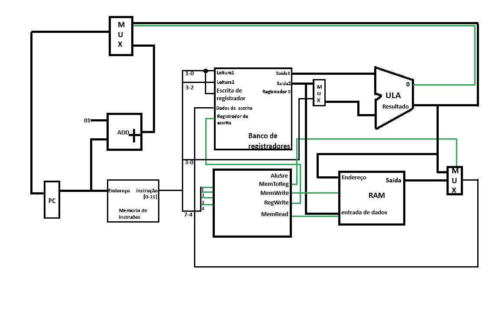
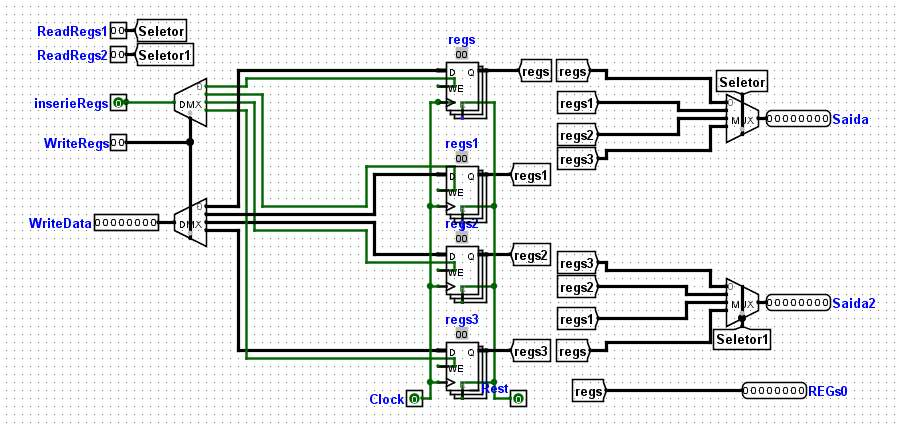
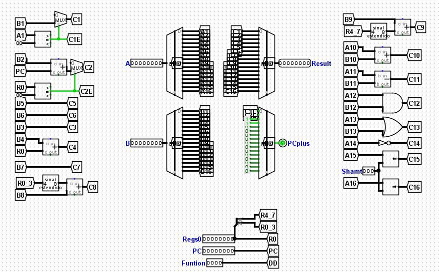
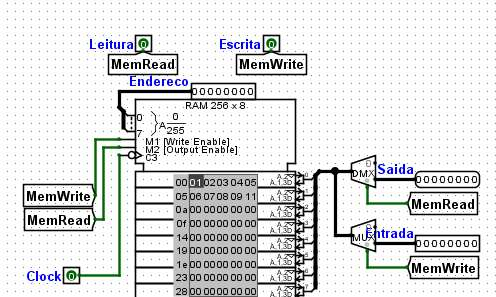
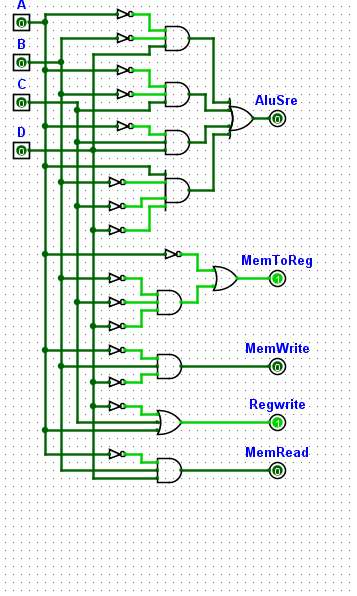
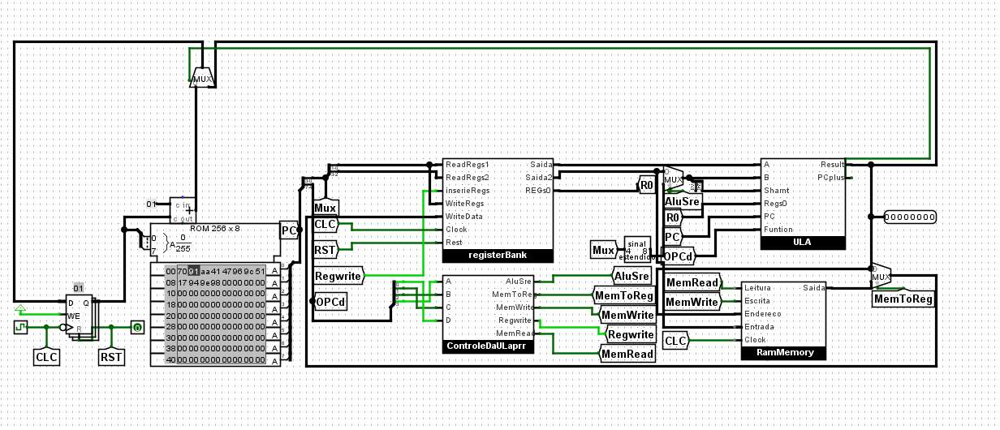

<div align="center">

# 🐺 Lobo-Guará — Processador de 8 bits

**Processador de 8 bits projetado do zero no Logisim-evolution**
*Projeto de Arquitetura de Computadores*


</div>

---

## 📖 Sobre o projeto

O **Lobo-Guará** é um processador simples de **8 bits** construído no **Logisim-evolution**, com o objetivo de entender na prática como funciona o caminho de dados de uma CPU: da busca da instrução na memória até a escrita do resultado no registrador.

O projeto foi montado por partes (banco de registradores → ULA → RAM → unidade de controle) e depois integrado no circuito `main`.

## 🧩 Componentes

| Circuito | Função |
| :--- | :--- |
| `registerBank` | Banco com 4 registradores de 8 bits, 2 portas de leitura e 1 de escrita |
| `ULA` | Unidade Lógica e Aritmética com 16 funções selecionadas por 4 bits |
| `RamMemory` | RAM 256 × 8 para as operações de *load* e *store* |
| `ControleDaULaprr` | Unidade de controle (portas lógicas) gerada a partir de uma tabela verdade |
| `main` | Circuito principal: PC, ROM de instruções e integração de todos os blocos |

## 🗺️ Caminho de dados

<div align="center">
  
</div>

O **PC** envia o endereço para a **ROM**, que devolve a instrução de 8 bits. Esses bits são divididos em duas partes de 4 bits:

- 4 bits vão para o **banco de registradores** (seleção dos registradores);
- 4 bits vão para a **unidade de controle da ULA**, que gera os sinais de controle.

A ULA executa a função escolhida e o resultado é exibido na saída. Por fim, o sinal volta ao **PC**, onde é somado `+4`; caso seja um *branch*, ele salta para o endereço informado.

## 🔧 Detalhes de cada bloco

### 1. Banco de registradores (`registerBank`)

Foi o primeiro passo do projeto. Possui 4 registradores de 8 bits e as seguintes portas:

| Porta | Descrição |
| :--- | :--- |
| `ReadRegs1` / `ReadRegs2` | Escolhem (via multiplexador) qual dos 4 registradores aparece em `Saida` e `Saida2` |
| `InserirRegs` + `WriteRegs` | Trabalham juntos na escrita: o demultiplexador envia o sinal para o registrador escolhido pelo código binário de `WriteRegs` |
| `WriteData` | Valor que será gravado no registrador escolhido |
| `Regs0` | Registrador fixo com valor `0`, usado mais adiante no processador |

Códigos de seleção: `00` → 1º registrador · `01` → 2º · `10` → 3º · `11` → 4º.

<div align="center">
  
</div>

### 2. ULA (`ULA`)

A ULA executa as **16 funções** do processador. Possui 5 entradas:

| Entrada | Descrição |
| :--- | :--- |
| `A` e `B` | Operandos da operação; o resultado sai em `Result` |
| `Function` | 4 bits que escolhem a função (ex.: `1001` = 9 = **soma**) |
| `PC` | Usada por algumas funções específicas (juntamente com `Regs0`) |
| `Shamt` | Auxiliar das operações de *shift* (deslocamento de bit para esquerda/direita) |

**Exemplo:** para somar, coloque `1001` em `Function`, informe os valores em `A` e `B` e leia o resultado em `Result`.

Internamente, o `Regs0` é dividido em dois túneis de 4 bits (`R0_3` = bits 0 a 3 e `R4_7` = bits 4 a 7), usados em algumas operações.

<div align="center">
  
</div>

### 3. Memória RAM (`RamMemory`)

RAM de **256 × 8 bits** com os sinais `MemRead` (leitura) e `MemWrite` (escrita). É nela que as instruções **load** e **store** leem e gravam dados.

<div align="center">
  
</div>

### 4. Unidade de controle da ULA (`ControleDaULaprr`)

Recebe 4 bits (`A`, `B`, `C`, `D`) e gera os sinais de controle usados no `main` em *load*, *store*, *branch* e outras funções. Foi construída a partir da tabela verdade abaixo.

| A | B | C | D | AluSrc | MemToReg | MemWrite | RegWrite | MemRead |
|:-:|:-:|:-:|:-:|:-:|:-:|:-:|:-:|:-:|
| 0 | 0 | 0 | 0 | 0 | 1 | 0 | 1 | 0 |
| 0 | 0 | 0 | 1 | 1 | 1 | 0 | 0 | 0 |
| 0 | 0 | 1 | 0 | 1 | 1 | 0 | 1 | 0 |
| 0 | 0 | 1 | 1 | 1 | 1 | 0 | 1 | 0 |
| 0 | 1 | 0 | 0 | 0 | 1 | 1 | 1 | 0 |
| 0 | 1 | 0 | 1 | 0 | 1 | 0 | 0 | 1 |
| 0 | 1 | 1 | 0 | 0 | 1 | 1 | 1 | 0 |
| 0 | 1 | 1 | 1 | 1 | 1 | 0 | 1 | 1 |
| 1 | 0 | 0 | 0 | 1 | 1 | 0 | 1 | 0 |
| 1 | 0 | 0 | 1 | 0 | 0 | 0 | 1 | 0 |
| 1 | 0 | 1 | 0 | 0 | 0 | 0 | 1 | 0 |
| 1 | 0 | 1 | 1 | 0 | 0 | 0 | 1 | 0 |
| 1 | 1 | 0 | 0 | 0 | 0 | 0 | 1 | 0 |
| 1 | 1 | 0 | 1 | 0 | 0 | 0 | 1 | 0 |
| 1 | 1 | 1 | 0 | 0 | 0 | 0 | 1 | 0 |
| 1 | 1 | 1 | 1 | 0 | 0 | 0 | 1 | 0 |

<div align="center">
  
</div>

### 5. Circuito principal (`main`)

Integra todos os blocos: o clock é gerado pelo **PC**, passa pela **ROM** (que escolhe qual instrução executar), alimenta o banco de registradores e a unidade de controle, e chega à ULA e à RAM.

<div align="center">
  
</div>

## ▶️ Como executar

1. Instale o [**Logisim-evolution**](https://github.com/logisim-evolution/logisim-evolution) (o projeto foi feito na versão `2.13.21.7`).
2. Baixe este repositório:
   ```bash
   git clone https://github.com/VittorSvt/NOME-DO-REPOSITORIO.git
   ```
3. Abra o arquivo `LOBOPT2.circ` no Logisim-evolution.
4. No circuito `main`, ative a simulação (`Simulate → Ticks Enabled`) ou avance o clock manualmente com `Ctrl + T`.
5. A ROM já vem com um programa de exemplo carregado; acompanhe os valores nos registradores e na saída.

## 📁 Estrutura do repositório

```
.
├── LOBOPT2.circ        # Projeto do Logisim-evolution
├── LOBOPT1.pdf         # Documentação do projeto
├── Imagens/            # Prints usados neste README
└── README.md
```

## 🛠️ Tecnologias

- [Logisim-evolution](https://github.com/logisim-evolution/logisim-evolution)
- Lógica digital · Arquitetura de computadores · Projeto de ULA e caminho de dados

## 👨‍💻 Autor

**Vitor Silva** — estudante de Ciência da Computação
[](https://www.linkedin.com/in/vitor-silva-386939297/)
[](https://www.instagram.com/p.vittor_/)
